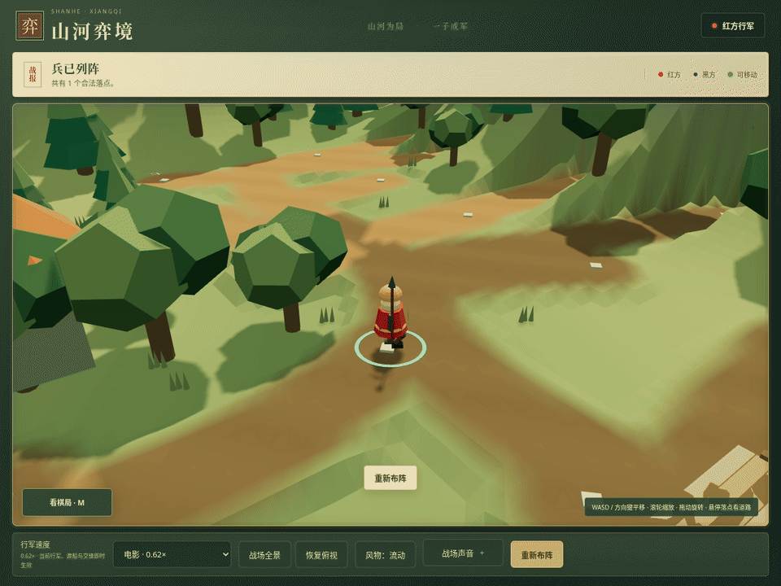

# 棋子步态与战场反馈

后续七类棋子形态、独立行走与奔跑、各兵种旗帜见[七军形态与动作](troop-identity.md)。

本轮保留山河弈境的简绘 3D 风格。棋子根节点高度仍为 .545，缩放仍为 .68。象棋规则、90 个站位、地形路线与渡船调度保持原样。GitHub Pages 继续暂停。

## 棋子直接站在道路上

移除常驻圆盘和金边，并同时取消旧圆盘的抬高偏移。选中棋子时显示薄提示圈。脚掌、马蹄和车轮直接接近道路顶面。

| 兵种 | 行军动作 |
| --- | --- |
| 兵卒 | 双腿交替迈步，膝关节弯曲，靴子抬起和落地。 |
| 将帅 | 较短、较稳的重甲步幅。 |
| 士 | 小步行军，较长的落脚时间。 |
| 马 | 四肢交替快步，狭窄桥栈切换为谨慎步态，骑手双腿保持乘坐姿势。 |
| 象 | 四足重步，支撑时间更长，攻击时单独抬起前足。 |
| 车 | 四个辐条轮按真实轮径转动。 |
| 炮 | 两个较大的辐条轮转动，炮身保持稳定。 |

步态按实际行进距离推进。泥路增加抬脚幅度，桥栈缩短步幅。等待、乘船、停止和减少动态效果时恢复站姿。乘船时车轮停止。重新布阵重置步态和轮子。

数据由 `LocomotionRig` 集中管理。`Model the Domain` 促成明确的腿和轮轴类型。对比两个方案后采用足部轨迹与双骨骼 IK，避免仅靠角度关键帧摆腿。

## 修复道路顶面竞争

旧石板顶面与地形同处 .54，部分交叉道路又重复铺板。现在把石路颜色写入地形，把溪流桥面合为每个区域只绘制一次的顶面，并用连续顶面替代桥梁和弯曲栈道的重叠铺板。新桥栈顶面为 .542，棋子根节点仍为 .545。渡船与落脚支撑通过原有容差检查。

`Fix Root Causes` 促成移除共面叠层，并消除共享材质的深度偏移修改。修复没有采用关闭深度检测或随机调整绘制顺序。

## 镜头与风物

点击棋盘后，按住 WASD 或方向键平移视角。移动方向跟随当前镜头朝向，对角线速度不会叠加。滚轮缩放和拖动旋转继续可用。速度菜单、音量条与棋局小图保留自己的键盘操作。窗口失焦会清除按键状态，恢复俯视也会停止平移。操作区换行不会再重置镜头。

瀑布新增沿原有坡面向下移动的白水带，河面亮纹跟随河道弯曲。湖面涟漪、树冠、草丛、飘叶和山雾持续变化。风物开关与系统减少动态效果设置都能恢复并冻结装饰。山体、地面、道路和支撑几何不随风移动。

## 交锋横幅

横幅采用宽金属板、铜边、铆钉和交叉兵器。实际命中触发一次局部震动、金属亮线和短促火星。横幅不拦截棋盘指针操作。手机上缩为紧凑横幅，印章保持单列竖排。减少动态效果时保留静态战报。

金属类攻击叠加短暂的非整数倍泛音和噪声敲击。声音开关同时控制这层音效。士、象保留原有的非金属攻击反馈。

## 实机对比与动图

旧版本来自 `58097a5` 的隔离副本。下列图片均为 Chromium 的实际 WebGL 输出。

| 内容 | 改造前 | 改造后 |
| --- | --- | --- |
| 棋子落脚 | [圆盘承托](../screenshots/living-troops/before/03-troop-detail.png) | [关节与靴子](../screenshots/living-troops/after/03-troop-detail.png) |
| 瀑布 | [静态水面](../screenshots/living-troops/before/02-waterfall.png) | [下落水带](../screenshots/living-troops/after/02-waterfall.png) |
| 横幅 | [窄战报](../screenshots/living-troops/before/04-battle-banner.png) | [宽金属横幅](../screenshots/living-troops/after/04-metal-battle-banner.png) |
| 路口 | [近景](../screenshots/living-troops/before/09-road-junction.png) | [近景](../screenshots/living-troops/after/09-road-junction.png) |
| 路口斜角 | [斜角](../screenshots/living-troops/before/10-road-junction-oblique.png) | [斜角](../screenshots/living-troops/after/10-road-junction-oblique.png) |



| 动图 | 时长 | 完整解码帧数 |
| --- | --- | --- |
| [七类兵种行军](../screenshots/living-troops/after/07-seven-troop-marches.gif) | 约 14 秒 | 112，全部不同。 |
| [瀑布与微风](../screenshots/living-troops/after/06-waterfall-and-breeze.gif) | 约 4 秒 | 32，全部不同。 |
| [金属交锋](../screenshots/living-troops/after/08-metal-impact.gif) | 约 2 秒 | 16，全部不同。 |

动图使用受控浏览器时钟调用原有动画回调，并逐帧读取真实 WebGL 图像。中间不需要截图的渲染被省略，保存的帧调用原有渲染方法。输出为 960 × 720、每秒 8 帧。它们用于观察动作，不代表设备实时帧率。GIF 不包含声音。

## 验证结果

`Prove It Works` 促成实际走子、原生按键和逐帧支撑检查。完整测试为 71 项通过，生产构建通过。构建仍提示主包超过 500 kB，本轮没有宣称性能提升。

- 七类棋子均完成实际行军与攻击，命中各触发一次。
- 双向渡船运行期间持续检测支撑，未出现无支撑样本。原生检测读取新模型的实际轮子四元数，确认乘船与等待时停转。
- WASD 和方向键在两个镜头朝向下共 16 个用例通过。对角线、表单焦点、失焦和视角恢复检查通过。
- 七类风物变化均在实际更新循环中被观察到。18 条瀑布水带在一次 200 ms 观察中有 17 条下降，其余一条经过循环回到上游。
- 风物关闭与减少动态效果时冻结检查通过，地形和支撑保持静止。
- 金属音效离线合成有信号且衰减到零。实际攻击只调度一次金属敲击，音效关闭时不调度。
- 390 px 页面没有横向溢出，横幅与减少动态效果检查通过。浏览器没有记录错误。

完整结果与帧数位于 [verification.json](../screenshots/living-troops/after/verification.json)。动图大小、哈希和实际解码时长位于 [gif-validation.json](../screenshots/living-troops/after/gif-validation.json)。[独立最终复核](../.audit/living-final-review.md) 为 PASS+NOTES，采用相同继承模型，未宣称跨模型共识。

脚掌约束以直线路段为准。急转弯和桥栈步幅过渡仍可能出现少量水平滑动。道路验证覆盖有限的采样位置与拍摄角度，不能据此保证所有视角完全没有闪烁。

## 复现

先运行 `npm run dev`。另一个终端运行以下命令。

```sh
npm test
npm run build
python3 scripts/verify-living-troops.py
python3 scripts/verify-living-troops.py --record
python3 scripts/capture-living-troops.py --stage after
```

浏览器脚本需要 Playwright、`/usr/bin/chromium`，录制还需要 FFmpeg。测试接口仅注入本地浏览器响应，不加入产品发布包。
