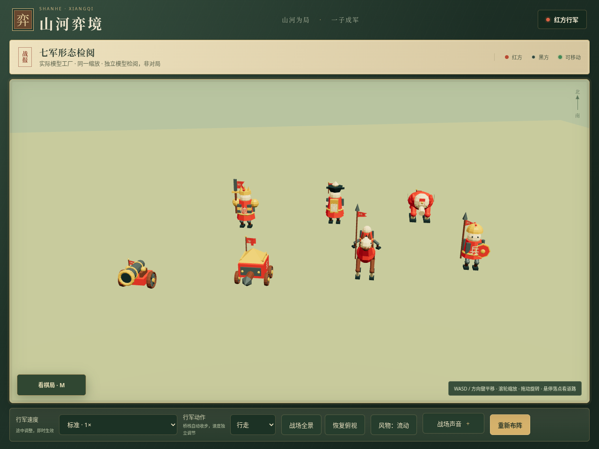

# 七军形态与行走、奔跑、交锋

本轮继续使用现有卡通简绘风格。棋子本体和旗帜一起区分兵种，保留根节点高度 .545、缩放 .68、90 个站位、道路和象棋规则。GitHub Pages 继续暂停。

## 兵种造型

| 兵种 | 本体特色 | 旗帜特色 |
| --- | --- | --- |
| 兵卒 | 片甲、盔顶短缨、眼睛、带金边和盾脐的圆盾。 | 紧凑三角背旗。 |
| 将帅 | 层叠指挥甲、三尖冠与冠带、短披风。 | 凹口燕尾令旗。 |
| 士 | 翼帽、长袍、袖口与玉笏嵌面。 | 窄长阶形文官旗。 |
| 马 | 鬃毛、缰饰、鞍具、口鼻、眼睛与马尾。 | 长枪上的骑兵小纛。 |
| 象 | 扇耳、短象牙、额饰与额前布。 | 梯形短鞍旗。 |
| 车 | 护栏、前甲、铆钉与辐条轮。 | 双齿短战旗。 |
| 炮 | 加固炮箍、暗色炮膛、木制炮架与耳轴盖。 | 锯齿炮营旗。 |

旗帜使用不同裁口，保留红黑阵营颜色。布边固定在旗杆上，自由端摆动。字样与布面共用几何和 UV，随同一批顶点变化。将帅与战车的字牌跟随躯干或车厢，士的正面字牌跟随玉笏，马耳跟随马头。



上图是实际生产模型工厂的独立检阅场景，用于比较形态，并非对局截图。下方动作记录来自真实棋局操作。

## 选择行军动作

在底部操作台选择 **行军动作 → 行走或奔跑**，再选择独立的播放速度。可以用慢速观察奔跑，也可以快速播放行走。动作选择改变姿态，不改变同一播放速度下的道路用时。选择合法敌方落点会自动进入兵种战斗动作。

行走采用较低抬脚和稳健持械。奔跑增加步幅、膝部抬高和持械倾角，骑手前倾、马头点动、象鼻摆动，车炮采用疾行姿态。桥梁和栈道优先采用谨慎行走。等待渡船和乘船时收脚、停止车轮与行军摆臂。减少动态效果时恢复静止姿态。

腿部仍由真实行进距离驱动，脚掌保持平放。更换步态在步态周期边界处理，并对支撑脚保留偏移，避免直线路段切换时滑动。现有七类战斗的蓄势、命中时间与恢复动作保持一致。

| 实机记录 | 内容 | 解码帧数 |
| --- | --- | --- |
| [兵卒行走与奔跑](../screenshots/troop-identity/after/pace-soldier.gif) | 前半行走，后半奔跑，约 4 秒。 | 32，全部不同。 |
| [骑兵行走与奔跑](../screenshots/troop-identity/after/pace-horse.gif) | 前半行走，后半奔跑，约 4 秒。 | 32，全部不同。 |
| [七军交锋](../screenshots/troop-identity/after/seven-troop-combat.gif) | 七类实际攻击与战报，约 14 秒。 | 112，全部不同。 |

这些动图使用受控浏览器时钟执行原有应用动画回调，并逐帧读取真实 WebGL 图像。输出为 960 × 720、每秒 8 帧，用于观察动作，不代表设备实时帧率。GIF 不包含声音。

## 前后对照

旧版本来自固定提交 `047a50b` 的隔离副本。新的装配包围盒没有超过旧版本的宽、高、深范围；将帅与战车因更换旧长旗而略收紧外包围。

| 证据 | 改造前 | 改造后 |
| --- | --- | --- |
| 七军检阅 | [旧模型](../screenshots/troop-identity/before/00-seven-troops.png) | [新模型](../screenshots/troop-identity/after/00-seven-troops.png) |
| 兵卒近景 | [旧模型](../screenshots/troop-identity/before/soldier.png) | [新模型](../screenshots/troop-identity/after/soldier.png) |
| 骑兵近景 | [旧模型](../screenshots/troop-identity/before/horse.png) | [新模型](../screenshots/troop-identity/after/horse.png) |
| 将帅近景 | [旧模型](../screenshots/troop-identity/before/general.png) | [新模型](../screenshots/troop-identity/after/general.png) |

## 验证

完整测试为 **146 项通过**，生产构建通过。新实机记录完成七兵种各两种步态，共十四次走子；在相同播放速度下，行走与奔跑的完成用时一致，终点、根高度和缩放一致。七次实际吃子均只命中一次。奔跑模式下的渡船记录有 306 帧、2754 次支撑射线检查，没有无支撑或车轮误转样本。

独立复核重复检查两种阵营的十四个模型、慢速行走与奔跑、途中切换、桥梁强制收步、布面固定边、阵营色、字样几何、关闭风物、减少动态效果与手机布局。独立复核也运行了 146 项测试和构建。

前后图复核曾发现旧版服务误指向工作目录，错误的旧图已被拒绝。重新启动明确指向隔离副本的服务后，比对了该副本的源文件与固定提交，并重录旧图。截图脚本现在会拒绝包含新模型工厂的旧版服务。此事与修正过程保留在审计记录中。

详见 [实机验证](../screenshots/troop-identity/after/verification.json)、[动图哈希与实际解码时长](../screenshots/troop-identity/after/gif-validation.json)、[独立复核](../.audit/troop-identity-review.md) 和 [最终源码哈希](../.audit/troop-identity-review-source.json)。

既有的弯道路段与逐渐收窄路面仍可能出现少量水平脚掌滑动。本轮没有引入持续的世界坐标脚掌锁定。模型检阅图不能单独证明棋局规则，规则与路面支撑由单元测试和实机走子另行验证。

## 设计取舍

`Model the Domain` 促成完整的七兵种旗帜配置和明确的行走、奔跑状态。`Experience First` 促成动作与播放速度分离，让慢速欣赏奔跑成为可用操作。`Prove It Works` 促成实际走子、十四个阵营模型检查，并拒绝错误的前后截图。

## 复现

先运行 `npm run dev`，再在另一个终端运行：

```sh
npm test
npm run build
python3 scripts/capture-troop-identity.py --stage after
python3 scripts/verify-troop-identity.py
python3 scripts/verify-troop-identity.py --record
```

截图与验证需要 Playwright 和 `/usr/bin/chromium`，录制还需要 FFmpeg。测试接口仅注入浏览器响应，不进入产品发布包。
